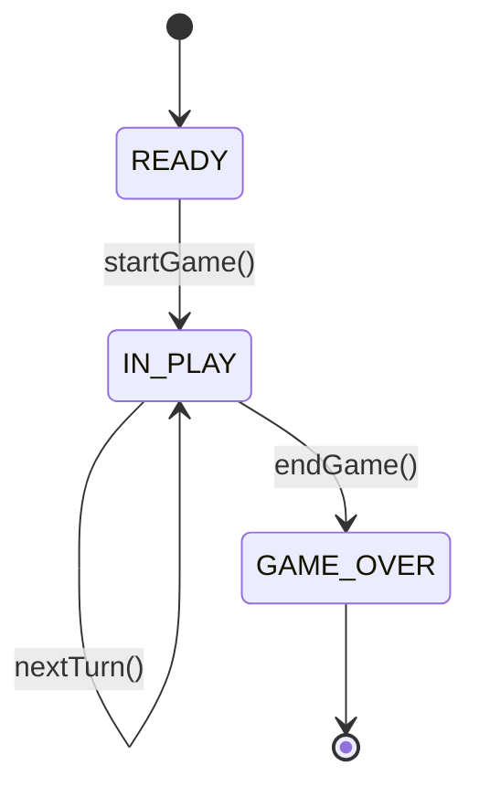

# Software Design and Architecture Readme

## Overview:

In this report I will walk through my Software Design and Architecture 
submission and detail the game variations and advanced features that were implemented. I will also discuss the design patterns used within the game code, and where the code adheres to SOLID principles. The architecture of the submission will also be discussed, and the report will also include a reflection of what went well during the project and what areas of the submission could be improved.

## Variations:

The first variation that was attempted was the single dice variation. This was attempted by having a RandomSingleDice class, which generated a number between 1 and 6. To then implement the double dice, a decorator in file DiceShakerDecorator was used. We also had a Fixed Dice which is used for some of the demonstration games, and dice rolls themselves are a value object. 

The next variation that was attempted was the exact end variation, where a player must land exactly on the end square, or else they'll be bounced back from the end by the number of squares they overshoot the end by. This is done using the Strategy pattern involving a movement type interface, with BasicMovement and ExactEndMovement implementing this. Basic Movement is used when a game allows for players to win on overshoot, whereas ExactEndMovement contains the logic for if a game wants exact end wins only. 

The next variation attempted was the hit rule variation, where if a player lands on a square occupied by another player, the turn is void and the player goes back to the square they occupied before the turn started. This was also done using the Strategy Pattern, with a HitRule interface, and ForfeitHitRule and NoHitRule classes implementing it. ForfeitHitRule loops through players in the game and if they share a position, it will return that in HitResult. 

The next variation attempted was the teleport rule, where if players land on a wormhole they are teleported to the other end of it. There is both a fixed version and random version of wormholes, and they are both validated using the wormhole validator. Wormholes can't spawn on a start or end square for any player, and two wormholes can not share an end point. As well as this, wormholes can not spawn one or both ends outside the board. Wormholes can be added with the teleport rule disabled ,and they are simply ignored, and teleport rule can be turned on but have no wormholes on the board

The last variation attempted was the large board variation, where four players play on a board with 36 squares. This was done using a path class and path factory, where preconfigured paths were used for players. Currently, the size of the board directly links to player count, with two players on a small board and 4 on a large board, but you cant have 4 on a small board or 2 on a large one. 

All variations are displayed using the games currently set up in Beans, with some of these games set up with fixed dice or wormholes, to ensure the variation is properly displayed. 

## Advanced Features

The first advanced feature attempted was the save and replay game feature. This was done using a replay game usecase that reads a game from a supplied repository type, and then runs the game through the game code. The games can be saved in two ways, either using an in memory store that resets at runtime, or as JSON in a file. JSON files are also deleted at runtime, but this feature could easily be removed in the future without touching game code. To choose which save type to use, comment one line in the gameRepository bean in GameConfig, and the other will be used. Only one save type currently works at a time currently. JSON files were made using Jackson, and in memory storage uses a map. 

The other advanced feature attempted was a State Machine. This advanced feature was very heavily based on the example in Lab 7, but was ammended for the game, and controls the game phases. A diagram below shows how the state machine works for our game: 

READY state is used while the game set up is being displayed, and moves to IN PLAY before the first turn takes place. For every turn taken the game remains in IN PLAY, until a player wins and then end_game() is called and GAME OVER state displays. Any additional rolls added in a fixed dice do nothing after this. The machine operates per game instance, although this can be changed in the future using the reset function. 

## Solid Principles

