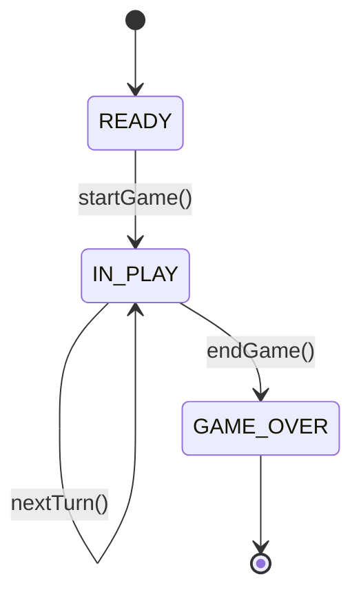
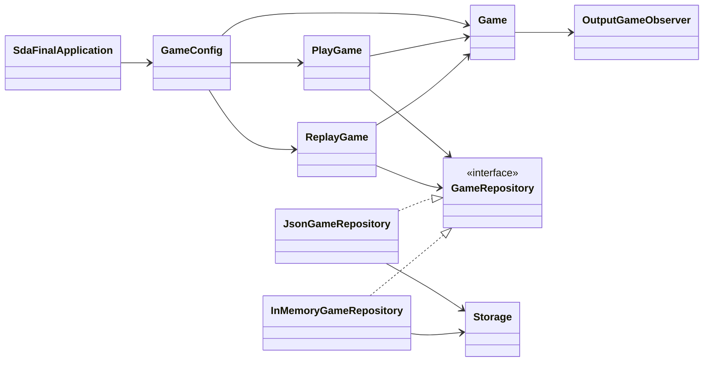

# Software Design and Architecture Readme

## Overview:

In this report I will walk through my Software Design and Architecture 
submission and detail the game variations and advanced features that were implemented. I will also discuss the design patterns used within the game code, and where the code adheres to SOLID principles. The architecture of the submission will also be discussed, and the report will also include a reflection of what went well during the project and what areas of the submission could be improved.

## Variations:

The first variation that was attempted was the single dice variation. This was attempted by having a RandomSingleDice class, which generated a number between 1 and 6. To then implement the double dice, a decorator in file DiceShakerDecorator was used. We also had a Fixed Dice which is used for some of the demonstration games, and dice rolls themselves are a value object. 

The next variation that was attempted was the exact end variation, where a player must land exactly on the end square, or else they'll be bounced back from the end by the number of squares they overshoot the end by. This is done using the Strategy pattern involving a movement type interface, with BasicMovement and ExactEndMovement implementing this. Basic Movement is used when a game allows for players to win on overshoot, whereas ExactEndMovement contains the logic for if a game wants exact end wins only. 

The next variation attempted was the hit rule variation, where if a player lands on a square occupied by another player, the turn is void and the player goes back to the square they occupied before the turn started. This was also done using the Strategy Pattern, with a HitRule interface, and ForfeitHitRule and NoHitRule classes implementing it. ForfeitHitRule loops through players in the game and if they share a position, it will return that in HitResult. 

The next variation attempted was the teleport rule, where if players land on a wormhole they are teleported to the other end of it. There is both a fixed version and random version of wormholes, and they are both validated using the wormhole validator. Wormholes can't spawn on a start or end square for any player, and two wormholes can not share an end point. As well as this, wormholes can not spawn one or both ends outside the board. Wormholes can be added with the teleport rule disabled ,and they are simply ignored, and teleport rule can be turned on but have no wormholes on the board

The last variation attempted was the large board variation, where four players play on a board with 36 squares. This was done using a path class and path factory, where preconfigured paths were used for players. Currently, the size of the board directly links to player count, with two players on a small board and 4 on a large board, but you cant have 4 on a small board or 2 on a large one. 

All variations are displayed using the games currently set up in Beans, with some of these games set up with fixed dice or wormholes, to ensure the variation is properly displayed. 

## Advanced Features

The first advanced feature attempted was the save and replay game feature. This was done using a replay game usecase that reads a game from a supplied repository type, and then runs the game through the game code. The games can be saved in two ways, either using an in memory store that resets at runtime, or as JSON in a file. JSON files are also deleted at runtime, but this feature could easily be removed in the future without touching game code. To choose which save type to use, comment one line in the gameRepository bean in GameConfig, and the other will be used. Only one save type currently works at a time currently. JSON files were made using Jackson, and in memory storage uses a map. 

The other advanced feature attempted was a State Machine. This advanced feature was very heavily based on the example in Lab 7, but was amended for the game, and controls the game phases. A diagram below shows how the state machine works for our game: 

READY state is used while the game set up is being displayed, and moves to IN PLAY before the first turn takes place. For every turn taken the game remains in IN PLAY, until a player wins and then end_game() is called and GAME OVER state displays. Any additional rolls added in a fixed dice do nothing after this. The machine operates per game instance, and a new context is made for each game. 

## Solid Principles

The implementation of the game adheres to the SOLID principles throughout the domain code and use cases.

### Single Responsibility Principle:

Most classes throughout the project adhere to SRP and have a single, defined responsibility. An example of this is the game code, which coordinates game flow, while rules and results are handled by other classes. 

### Open/Closed Principle:

The system is designed to be open for extension but closed for modification. New behaviours can be introduced by adding implementations of interfaces such as HitRule, WinCondition and TeleportRule, without modifying the core game class. 

### Liskov Substitution Principle 

All implementations of interfaces can be substituted without affecting correctness of the system. For example, replacing BasicMovement with ExactEndMovement does not require changes to the Game class.

### Interface Segregation Principle

The system aims to use small interfaces rather than more general ones. For example, rule interfaces such as HitRule and TeleportRule are kept specific to their use. 

### Dependency Inversion Principle

Game depends on abstractions rather than concrete implementations, infrastructure components also depend on domain abstractions rather than concrete implementations. 

## Design Patterns Used

The first pattern implemented was the Strategy Pattern, supporting changeable game rules and behaviours. This is used for several components including exact end, hit rule, movement and teleport rule. This was used to allow for multiple implementations of an interface, and helped allow for easier game configuration. 

Another pattern used in the project was the Observer Pattern, used for outputting game events to the console. This is used in OutputGameObserver, as well as in the observer and event packages. This separates presentation logic from the core game logic while still allowing the game to publish events.

State pattern was used to implement a State Machine for game flow. Related classes are located in the gameState package within the domain layer. This removes the need for conditional logic which was being used until the state machine was implemented.

The decorator pattern was used to enable a double dice. This allows us to extend our dice without having to change the core dice logic. 

A facade was implemented in the game code but then later removed as it was redundant once the game was added into springboot. Game Factories were also removed for the same reason, although a factory does still exist for adding players to a game. 

## Architecture 

The system follows a clean architecture approach, separating the application into domain, use cases and infrastructure. 

The domain layer contains the core game code including the game class, rule implementations, state machine and event system. The layer is independent of infrastructure and handles game logic. 

The use case layer coordinates execution of the game and replay, and handles interactions between the domain and infrastructure. 

The infrastructure provides external usage for output and persistence. This includes the repository implementations and the OutputGameObserver used for console output. 

The diagram below illustrates the architecture:

## Reflection

Overall, the implementation does a good job at demonstrating the game variations, advanced features, design patterns and architectural principles. One of the strongest aspects is the separation of concerns between domain, use cases, and infrastructure. The use of patterns such as Strategy and Observer allow for maintainability and extensibility, as new behaviours can be added without modifying existing core code. 

However, the code could definitely be improved further by allowing for the user to dynamically choose rules through a command line at runtime. The same thing can be said of the type of game store too, and this was attempted but scrapped due to time constraints and risk of creating bugs. It also would have been nice to add the ability to save to both at the same time, and this was also attempted and then scrapped.

Overall the project provided valuable experience and displays a good level of functionality and usage of design patterns, but could have been implemented better to provide more interaction. 
